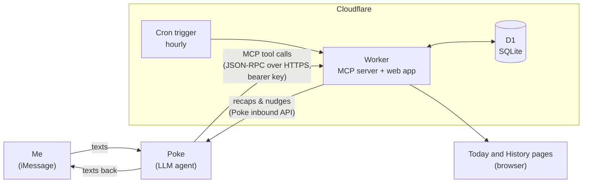

# Health

**A personal food, sleep, and gym tracker you use by texting.** You text your AI agent what you ate, when you went to bed, and when you woke up. It estimates calories and macros, logs everything to this app over the [Model Context Protocol](https://modelcontextprotocol.io), and shows which of your four daily goals you hit.

No calorie-counting app, no forms, no barcode scanning. Just texts like these:

> **me:** greek yogurt with ¼ cup pb protein granola, pomegranate and blueberries
> **Poke:** Logged ~365 cal, 31g protein. You're at 1,120 / 1,700 cal and 88 / 120g protein. 32g to go.
> **me:** gn
> **Poke:** Bedtime logged at 12:40am.
> **me:** up
> **Poke:** 7h 25m. Sleep goal ✓ and up by 8:30 ✓.

---

## How it works



1. **The agent is the interface.** [Poke](https://poke.com) connects to the app as a custom MCP integration. Poke does the language understanding and the nutrition estimates. The app never runs its own model, so there's no AI bill on the server side.
2. **The app is an MCP server.** It exposes typed tools (`log_food`, `sleep_end`, `get_status`, …) over Streamable HTTP. Every request carries the owner's bearer key; any other key is refused.
3. **The server enforces the rules, not the model.** Scoring, day boundaries, and deadlines all live in deterministic TypeScript. The agent gets back plain-text results with running totals, so it can't drift from what's stored.
4. **It talks back.** An hourly cron sends a 10am recap, a 9pm "here's what's left" check-in, and a Monday week summary through Poke's inbound API, so they arrive as normal iMessages.

## The goals

Four goals a day. There are no points: each goal is **hit**, **close** (within 10% on food, 30 minutes on sleep and wake-up), **missed**, or **nothing logged**, which is left blank instead of counting against you.

| | Cut | Bulk |
|---|---|---|
| 🔥 Calories | at or under target (never under a 1,200 floor) | at or over target |
| 💪 Protein | at or over target | at or over target |
| 😴 Sleep | 7h or more | 7h or more |
| ⏰ Wake-up | up by 8:30 weekdays, 10:30 weekends (10 min grace) | same |

- The Today page leads with your day in a sentence, then four rings that fill toward each goal, the week as a grid of squares, per-goal streaks, and 7-day averages.
- Food estimates aren't exact, so calories get 50 cal of grace past the target and protein 5g short of it (`CALORIE_GRACE`, `PROTEIN_GRACE_G`).
- Fat and carbs are tracked and shown but aren't goals.
- **Sugar (opt-in):** the agent estimates total and added sugar for every item, so you can track added (refined) vs natural sugar against a daily limit.
- **Gym consistency is tracked on the side, not scored:** this week's workouts (gym, sport, or run), a GitHub-style grid of every week on the history page, darker on days with two or more, and a streak of weeks that hit your weekly goal.
- Logging nothing doesn't count as a perfect cut day; it's blank.
- A bare total ("I hit 3,000 today") with no foods is saved but doesn't count toward the calorie or protein goal; the agent asks what was actually eaten.
- Weeks run Monday to Sunday.
- Days roll over at **4am**, so a 1am snack counts for the night before. Sleep counts toward the day you wake up.
- Tracking starts on `start_day` in the settings table, if it's set.

## MCP tools

| Tool | What it does |
|---|---|
| `log_food` | Log items with calories, protein, fat, carbs, and sugar (total and added); add to an existing meal or backdate up to a week |
| `edit_food` / `delete_food` | Fix or remove a single item ("actually it was 3 eggs") |
| `sleep_start` / `sleep_end` | "gn" and "gm"; computes duration and the wake-up goal |
| `log_sleep` | A whole night after the fact ("slept 1 to 8") |
| `get_status` | Current time, goals, today's and yesterday's meals with ids, workouts, the week's goals |
| `set_sugar_goal` | Turn on sugar tracking with an added-sugar limit, change it, or turn it off |
| `log_workout` / `remove_workout` / `set_workout_target` | Mark a gym, sport, or run day on the consistency grid, and set the weekly goal the streak counts |
| `set_goal` / `log_weight` | Goals and weigh-ins |

The server also sends the agent instructions on connect: log first and ask at most one clarifying question when a guess could be off by 150+ calories, and treat any phrasing of "going to bed" or "woke up" as sleep.

## Engineering notes

- **Agents and time zones.** LLMs often send ISO timestamps without an offset, or today's date in UTC (already tomorrow in California at 9pm). Offset-less times are read as wall-clock time in the app's time zone, including across DST changes. Future dates are clamped to the current day instead of rejecting a meal.
- **A 4am day.** Food uses a day that rolls over at 4am. Sleep belongs to the calendar day you wake up. Both are pure functions with unit tests.
- **Shipping features without a reconnect.** MCP clients cache the tool list, and a stateless server can't push `tools/list_changed`. New features therefore degrade gracefully: tool results carry short notes for the agent, sugar rides along as a tag in the item description (`"vanilla yogurt [sugar 16g, 9g added]"`, parsed and stripped server-side), and anything else gets a one-tap control on the page.
- **Exactly-once scheduled messages.** The hourly cron dedupes on keys like `recap:2026-09-30`, so a retried or overlapping run never double-texts.
- **One-time secrets.** The API key is shown once. The setup form uses post/redirect/get with a short-lived HttpOnly cookie, so refreshing can't silently rotate the key. Keys are stored as SHA-256 hashes.
- **Remembered devices, no logins.** The site sits behind one password (the join code), entered once per phone and remembered with a year-long HttpOnly cookie. Opening the private link Poke gives you does the same.
- **A hand-rolled MCP server.** Stateless Streamable HTTP with JSON-RPC 2.0, batch support, notifications, and protocol-version negotiation, with no SDK.
- **No frontend framework.** Pages are server-rendered HTML with light, dark, and ocean themes (following the phone's setting until you pick one), applied before first paint so they don't flash, and frosted translucent cards. Inter for numbers, Newsreader for the journal-style sentences. The background is an animated ASCII field on a canvas. History is a week-by-week table of goals hit, a day-by-day log (a square per goal, tap a day for the numbers) plus server-rendered SVG trend charts: daily bars that are solid when the goal was hit and faded when missed.

## Stack

- **Runtime:** Cloudflare Workers (TypeScript), D1 (SQLite), and Cron Triggers, all on the free tier
- **Agent:** [Poke](https://poke.com) over MCP, plus Poke's inbound API for outgoing texts
- **Frontend:** server-rendered HTML/CSS, inline SVG rings and charts, a canvas ASCII background, Inter and Newsreader, light/dark/ocean themes, installable to the home screen
- **Tests:** Vitest for scoring rules, day boundaries, time parsing, and MCP access

```
src/
  index.ts     routes, setup flow, password gate, scheduled messages
  mcp.ts       MCP server: JSON-RPC handling, tools, agent instructions
  game.ts      sleep logging, reports, status text, weekly totals
  scoring.ts   the scoring rules as pure functions
  gym.ts       weekly workout counts and streaks
  time.ts      time zones, 4am rollover, ISO parsing
  web.ts       today, history charts, setup
  poke.ts      outgoing messages via Poke
  db.ts        D1 queries
migrations/    schema
test/          unit tests
```

## Run your own

You need a free Cloudflare account and a [Poke](https://poke.com) account.

1. **Deploy:** in Cloudflare, go to **Workers & Pages → Create → Import a repository**, pick your fork, set the deploy command to `npm run deploy`, and deploy.
2. **Create the tables:** run `npm run db:migrate` (or paste the files in `migrations/` into the D1 console).
3. **Set a join code:** add `JOIN_CODE` as a runtime Secret. It's also the site password.
4. **Set your name:** `OWNER_NAME` in `wrangler.toml`.
5. **Set up:** open `/join`. You get a key; add the app in Poke as a custom integration (MCP URL `https://<your-worker>/mcp`, API key = your key).
6. **Start texting:** "set my goal: cut, 1700 cal, 120g protein".

Tune the rules in `wrangler.toml`:

| Setting | Default | What it does |
|---|---|---|
| `OWNER_NAME` | `Dara` | the one player the app is for |
| `GAME_TZ` | `America/Los_Angeles` | the time zone everything runs on |
| `SLEEP_TARGET_HOURS` | `7` | hours needed for the sleep goal |
| `WAKE_WEEKDAY` / `WAKE_WEEKEND` | `08:30` / `10:30` | the wake-up deadline |
| `WAKE_GRACE_MINUTES` | `10` | minutes of grace on the wake-up deadline |
| `BREAK_DAYS` | | weekdays that use the weekend wake-up time |
| `CUT_FLOOR_CALORIES` | `1200` | a cut day under this never hits the calorie goal |

### Local development

```sh
npm install
npm test
cp .dev.vars.example .dev.vars
npx wrangler d1 migrations apply health-bet --local
npm run dev    # http://localhost:8787/join
```

---

Built by [Dara Miao](https://github.com/dara-miao), with [Claude Code](https://claude.com/claude-code).
